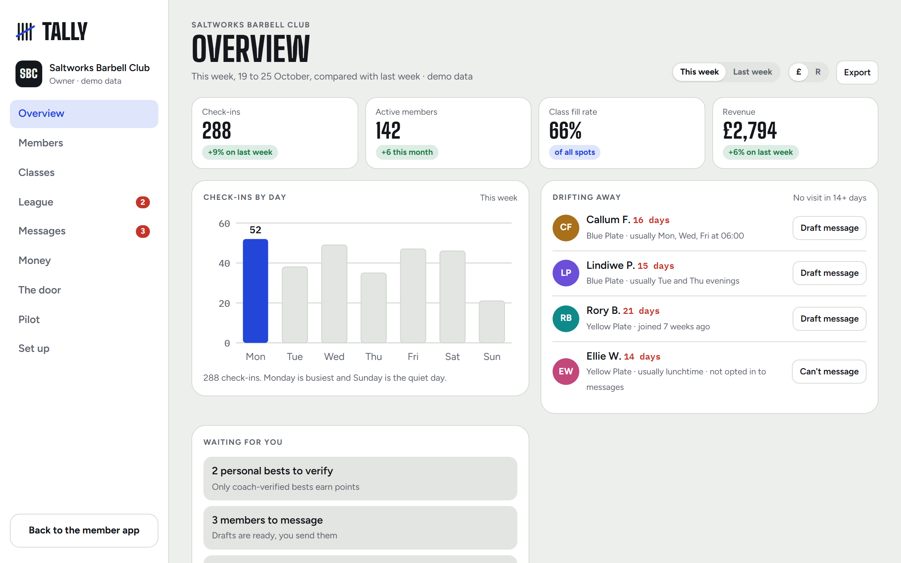
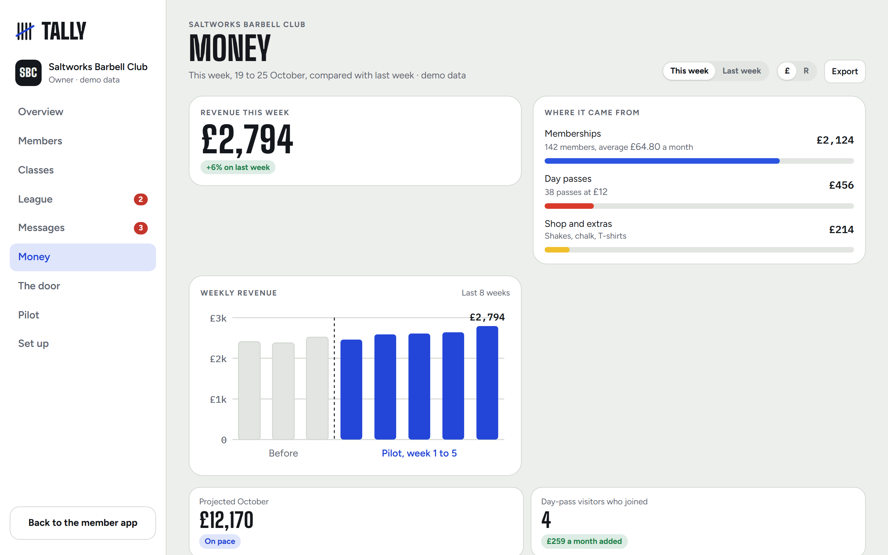
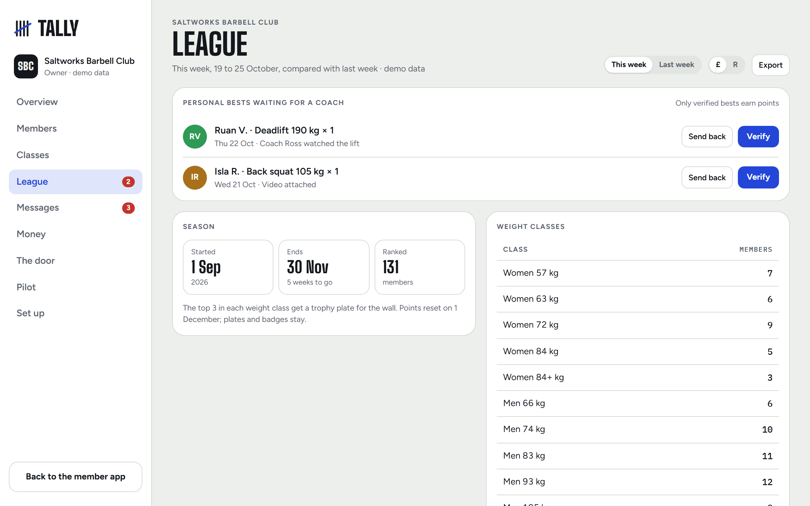
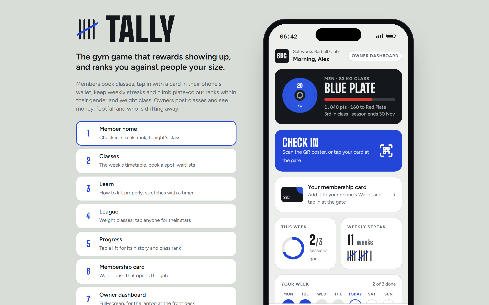
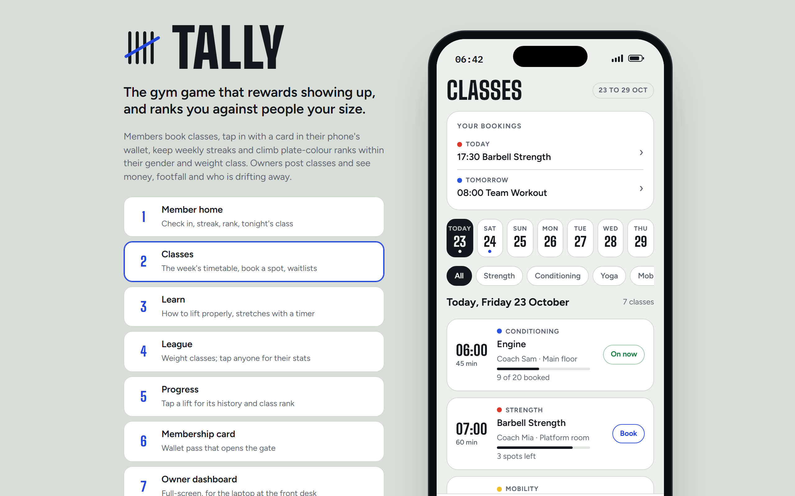
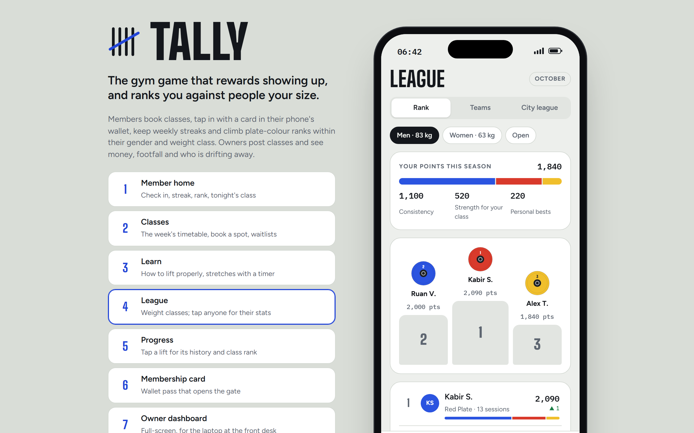
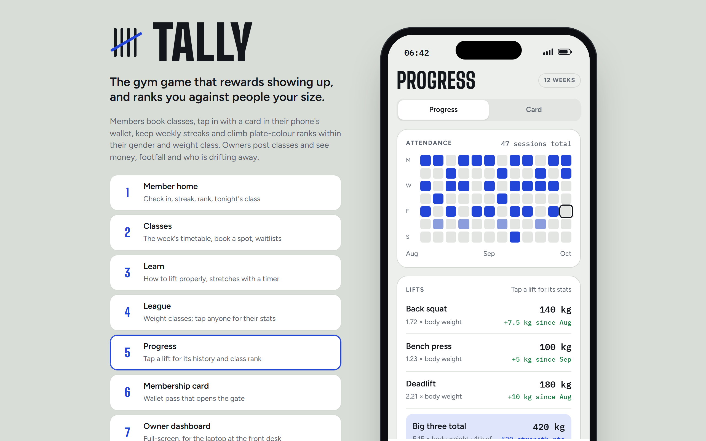
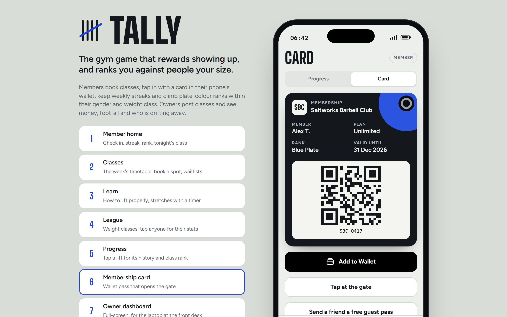
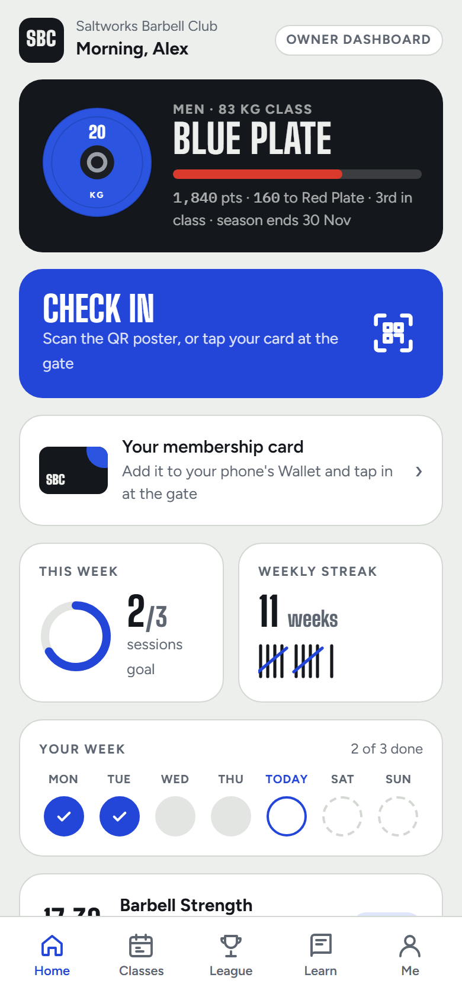
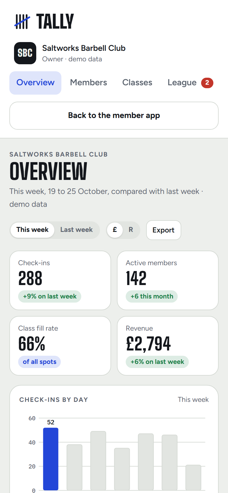

# Tally

Tally is an interactive demo of a gym membership and loyalty app: the gym game that rewards showing up, and ranks you against people your size. Members book classes, check in with a wallet card, keep weekly streaks and climb plate-colour ranks within their weight class. Owners get a full-screen dashboard showing money, attendance and members drifting away. It is a portfolio demo. The gym, "Saltworks Barbell Club", its members, classes and money are all made up.

A portfolio project by Josh Terblanche, who led it and made the product, design and business decisions. See the [case study](docs/CASE-STUDY.md).

## Live demo

https://joshterblanche18-cmd.github.io/tally-gym-app/

No sign-up is needed. This public repository is a fresh copy of the finished demo; the earlier working history is kept privately.

## Try it

- Press **Check in** on the member home screen.
- Open **Progress**, press **Log a lift** and log a back squat of 150 kg for 1 rep. That beats the demo member's 140 kg best, so it waits for a coach.
- Press **Owner dashboard**, open **League** and press **Verify**. The member gets 40 points.

Nothing is saved. A refresh puts the demo back to the start.

## Screenshots

<table>
  <tr>
    <td align="center" width="50%">
      
       Owner dashboard
    </td>
    <td align="center" width="50%">
      
       Money
    </td>
  </tr>
  <tr>
    <td align="center" width="50%">
      
       League and coach verification
    </td>
    <td align="center" width="50%">
      
       Member home
    </td>
  </tr>
  <tr>
    <td align="center" width="50%">
      
       Classes
    </td>
    <td align="center" width="50%">
      
       League
    </td>
  </tr>
  <tr>
    <td align="center" width="50%">
      
       Progress
    </td>
    <td align="center" width="50%">
      
       Membership card
    </td>
  </tr>
  <tr>
    <td align="center" width="50%">
      
       Phone: member home
    </td>
    <td align="center" width="50%">
      
       Phone: owner dashboard
    </td>
  </tr>
</table>

## Features

- Member home with check-in, weekly goal, streak, rank and tonight's class.
- A class timetable with booking and waitlists.
- League tables by gender and weight class, using plate-colour ranks from White to Red.
- Lift logging with history. A new best only earns points once a coach verifies it.
- A Learn section with lifting guides and stretches on a timer.
- A membership card, guest passes and a tap-at-the-gate demo.
- An owner dashboard with an overview, members, classes, league, messages, money, door and pilot screens.
- A Set up screen where the owner picks the gym type, and the member app changes to match.
- Message drafts that respect each member's choice about being contacted.

## Stack

| Part | What is used |
|---|---|
| Page | One self-contained HTML file with CSS and plain JavaScript |
| Libraries | None |
| Server and database | None: it runs entirely in the browser |
| Fonts | Google Fonts |
| Hosting | GitHub Pages (free) |

## Quality and measured results

Measured 2 November 2026 on this exact file, in Chromium, at laptop (1280 x 800) and phone (390 x 844) sizes.

- All 6 member screens and all 9 owner screens opened, with no page errors.
- Every button on those screens was pressed from a fresh page: 82 at each size, with no page errors. This shows nothing crashed. It does not check what each button should do.
- The steps in "Try it" for logging and verifying a lift, and for switching to the owner dashboard and back, passed at both sizes.
- It also opens by double-clicking `index.html`.

Not tested: real phones, browsers other than Chromium, or use without internet (the fonts would not load).

## Known limits

- It is a demo, not a working product. Nothing is saved, no real wallet card is issued and no message is sent.
- The dates are fixed in the demo, for example "19 to 25 October", so they will age.

## Security and privacy

- No accounts, no server, no database and no analytics code. The page asks for no real personal data.
- No API keys or passwords are needed, and none are in this repository. The files and history were scanned for keys, tokens and passwords before publishing.
- Visitors' browsers contact Google Fonts to load the fonts.

## Running locally

Download the repository and double-click `index.html`. There is nothing to install.

## Licence and credits

- Everything in the demo is invented: the gym, the people, the rival gyms and the figures. Any resemblance to real businesses or people is accidental.
- No licence is granted: all rights reserved. You are welcome to read the code.
